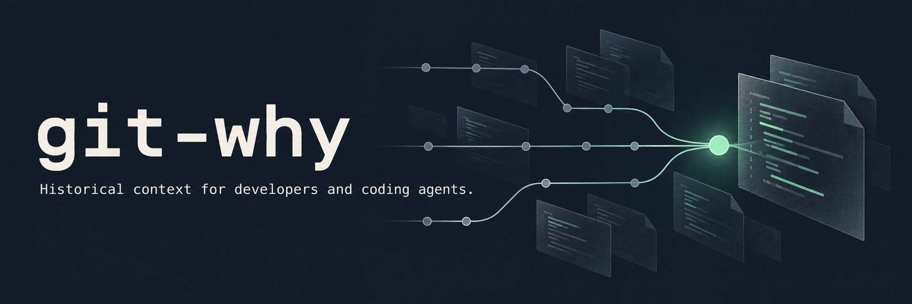

# git-why



**Historical context for developers and coding agents.**

[](https://github.com/Blancochuy/git-why/actions/workflows/ci.yml)
[](https://github.com/Blancochuy/git-why/releases)
[](LICENSE)

Understand why code exists, not just who wrote it. `git-why` brings together line attribution, commit messages, and history in a Go CLI, with an MCP server for coding agents.

[Demo](#demo) · [Installation](#installation) · [Quick start](#quick-start) · [Commands](#commands) · [MCP integration](#mcp-integration) · [Development](#development)

## Demo

See git-why in action on Cobra: inspect a line, trace a function, and retrieve context for a coding agent.

[](assets/git-why-terminal-demo.mp4)

[Watch the MP4](assets/git-why-terminal-demo.mp4) · About 54 seconds. See the [text examples](#quick-start) or [demo notes](assets/DEMO.md).

## Why git-why?

A line of code shows what happens today. Its history can explain the constraint, bug, or decision behind it. `git-why` retrieves that evidence so you can investigate an unfamiliar codebase or give a coding agent more context before a change.

- **Trace a line** to its attributed commit, author, message, and body.
- **Explore a range or function** through the commits that changed it.
- **Give agents historical evidence** through MCP or text output with `--llm`.

The tool retrieves existing evidence. How much that evidence explains depends on the repository's history and commit messages.

## Installation

Git must be installed and available on `PATH`. Go 1.23 or newer is required when installing from source.

### With Go

```bash
go install github.com/blancochuy/git-why@latest
git-why --version
```

Use the lowercase module path shown above. Add your Go binary directory to `PATH` if `git-why` is not found. By default, that directory is `$(go env GOPATH)/bin`, unless `GOBIN` is set.

To install a specific version:

```bash
go install github.com/blancochuy/git-why@v0.1.0
```

### Prebuilt binaries

Download an archive from [GitHub Releases](https://github.com/Blancochuy/git-why/releases), extract it, and place `git-why` or `git-why.exe` in a directory on `PATH`.

| Platform | Architectures | Archive |
| --- | --- | --- |
| Linux | amd64, arm64 | `.tar.gz` |
| macOS | amd64, arm64 | `.tar.gz` |
| Windows | amd64, arm64 | `.zip` |

Releases include SHA-256 checksums and Linux `.deb` and `.rpm` packages. Homebrew installation is not currently available.

## Quick start

Run commands from the root of a Git repository. These examples use files in this project:

```bash
# Inspect a line
git-why internal/render/ai_renderer.go:20 --plain

# Follow the history of a range
git-why internal/render/ai_renderer.go:20-44

# Find commits that changed a function
git-why internal/render/ai_renderer.go --fn GetContext
```

The first command produces this output with the published v0.1.0 binary:

```text
Line 20 - 1e08ea65b536 - Added: 2026-03-03 by @jesus

Message:
  chore: optimize AI output for token efficiency and clean up diff headers
```

Dates are displayed in the local timezone and can vary by machine.

## Commands

| Task | Command |
| --- | --- |
| Inspect a line | `git-why <file>:<line>` |
| Follow a range | `git-why <file>:<start>-<end>` |
| Follow a function | `git-why <file> --fn <name>` |
| Search commit messages | `git-why search <file> --term <text>` |
| Search with a regular expression | `git-why search <file> --term <pattern> --regex` |
| View file authorship and activity | `git-why stats <file>` |
| Read line numbers from stdin | `git-why watch <file>` |
| Start the MCP server | `git-why mcp` |

Line numbers start at 1. Function lookup uses patterns for Go, TypeScript, JavaScript, Python, Java, and Rust; it is not a full language parser. Commit search matches subjects and bodies, without searching patch contents.

```bash
git-why search internal/render/ai_renderer.go --term "token"
git-why stats internal/render/ai_renderer.go --json
git-why --help
```

Generate shell completions with `git-why completion bash`. Also available: `zsh`, `fish`, and `powershell`.

### Output formats

For line, range, and function queries, choose one output mode:

| Flag | Output |
| --- | --- |
| `--plain` | Terminal text without ANSI colors |
| `--short` | One line per commit |
| `--json` | Structured JSON |
| `--md` | Markdown |
| `--llm` | Text formatted for a consuming agent |

Single-line queries include the commit patch with `--include-diff`. The `--llm` mode includes it automatically. Range and function queries list commits rather than inline patches.

```bash
git-why internal/render/ai_renderer.go:20 --json
git-why internal/render/ai_renderer.go:20-44 --md
git-why internal/render/ai_renderer.go:20 --llm
```

## MCP integration

The MCP server exposes repository history to a compatible client over stdin/stdout. It does not require a model API key or call a model itself.

Install the binary, then add this entry to your client's MCP configuration:

```json
{
  "mcpServers": {
    "git-why": {
      "command": "git-why",
      "args": ["mcp"]
    }
  }
}
```

Configure the client to launch the server with the target repository root as its working directory. If the client cannot find `git-why` on `PATH`, use the absolute path to the binary in `command`. Configuration file locations and working-directory settings depend on the client.

### Available tools

| Tool | Arguments | Result |
| --- | --- | --- |
| `git-why-context` | `file` and either `line` or `range` | Commit context for a line, or commit history for a range |
| `git-why-stats` | `file` | Line counts, commit counts, and contributor attribution |

Paths are relative to the repository root. A `range` uses the form `"10-20"` and takes precedence when both `line` and `range` are supplied.

Single-line context includes commit metadata and a patch. When `origin` points to GitHub, it also attempts to retrieve an associated pull request. Range responses list commit metadata.

### Configuration

| Environment variable | Purpose |
| --- | --- |
| `GITHUB_TOKEN` | Authenticate optional GitHub PR lookups |
| `GITWHY_TOKEN` | Fallback when `GITHUB_TOKEN` is unset |
| `GITWHY_CACHE_DIR` | Override the API cache directory, which defaults to `~/.cache/git-why` |

CLI history queries use local Git data. MCP single-line queries can contact GitHub for PR enrichment, sending the repository identifiers and commit SHA. Retrieved commit messages and PR text are evidence for the consuming agent to assess.

<details>
<summary>Test the stdio protocol manually</summary>

The server reads one JSON-RPC message per line. This Bash example initializes a session, discovers tools, and requests a range:

```bash
printf '%s\n' \
  '{"jsonrpc":"2.0","id":1,"method":"initialize","params":{"protocolVersion":"2024-11-05","capabilities":{},"clientInfo":{"name":"manual-test","version":"1.0"}}}' \
  '{"jsonrpc":"2.0","method":"notifications/initialized"}' \
  '{"jsonrpc":"2.0","id":2,"method":"tools/list"}' \
  '{"jsonrpc":"2.0","id":3,"method":"tools/call","params":{"name":"git-why-context","arguments":{"file":"internal/render/ai_renderer.go","range":"20-44"}}}' \
  | git-why mcp
```

Each response is a JSON object on a single line. The initialization notification does not produce a response.

</details>

## Development

```bash
git clone https://github.com/Blancochuy/git-why.git
cd git-why
go test -race ./...
go vet ./...
go build -o git-why .
```

CI runs tests with the race detector, `go vet`, and a build on Ubuntu. Release builds target Linux, macOS, and Windows. Source builds report `dev` unless version metadata is supplied at build time.

### Code layout

| Directory | Responsibility |
| --- | --- |
| [`cmd/`](cmd/) | CLI commands and output selection |
| [`internal/git/`](internal/git/) | Git execution, history parsing, and function lookup |
| [`internal/mcp/`](internal/mcp/) | MCP transport and tool handlers |
| [`internal/render/`](internal/render/) | Terminal and agent-oriented context rendering |
| [`internal/enricher/`](internal/enricher/) | Hosting API clients; GitHub PR lookup is wired into MCP |
| [`internal/cache/`](internal/cache/) | API response caching |

### Current limits

- Available history determines the context the tool can retrieve. Shallow clones may omit relevant commits.
- A line with uncommitted changes returns an error because it has no committed attribution.
- Agent-oriented single-line patches can be truncated. Range responses do not include full patches or PR enrichment.
- The GitLab API client exists but is not connected to commands or MCP handlers.
- MCP handlers are tested over stdio. Desktop client compatibility has not been verified end to end.

See the [changelog](CHANGELOG.md) for release history and the [release workflow](.github/workflows/release.yml) for publishing configuration.

## Contributing

Bug reports and contributions are welcome. Read the [contribution guide](CONTRIBUTING.md), use the [support guide](SUPPORT.md) for questions, and follow the [code of conduct](CODE_OF_CONDUCT.md).

Report security issues through the process in [SECURITY.md](SECURITY.md).

## License

[MIT](LICENSE).
